# Architecture Specification: Cataclysm

## 1. Overview & System Purpose

**Cataclysm** is designed as a real-time crisis intelligence platform that ingests high-velocity disaster telemetry (such as floods, cyclones, earthquakes, wildfires, and infrastructure incidents) from multiple external sources (citizen reports, weather stations, sensors, and alert feeds), processes them through a streaming data pipeline, stores historical raw data in a data lake, maintains queryable relational records in PostgreSQL, runs ML classification/severity models, and renders live alerts on an interactive dashboard ([README.md:1-4](file:///e:/catalcysm/README.md#L1-L4), [docs/architecture.md:3-6](file:///e:/catalcysm/docs/architecture.md#L3-L6)).

---

## 2. Codebase Directory Structure

```
.
├── .gitignore                      # Python, Docker, data, and ML ignore patterns
├── compose.yaml                    # Docker Compose services (fastapi, db, broker)
├── Dockerfile                      # Python 3.11-slim container definition for FastAPI
├── requirements.txt                # Python backend dependencies
├── README.md                       # High-level platform summary and target stack
├── Crisis_Intelligence_Platform.pptx# Project presentation slides
├── docs/
│   └── architecture.md             # High-level architecture documentation & rationale
└── src/
    ├── api/
    │   ├── main.py                 # FastAPI application, REST endpoints, Kafka producer
    │   └── static/
    │       └── index.html          # Web ingestion & PostgreSQL verification dashboard
    ├── data/
    │   └── generator.py            # Synthetic disaster event generation script
    └── kafka/
        └── consumer.py             # Standalone Kafka consumer & PostgreSQL sink
```

---

## 3. Current Architecture vs Target Vision

```mermaid
flowchart TD
    subgraph CurrentImplementation["Current Working Implementation"]
        Gen["Synthetic Generator\n(src/data/generator.py)"] -->|POST /events| API["FastAPI Service\n(src/api/main.py:60)"]
        UI["Web Portal UI\n(src/api/static/index.html)"] -->|POST /events| API
        API -->|confluent-kafka produce| Kafka["Kafka Broker (KRaft)\nTopic: 'crisis-events'"]
        Kafka -->|confluent-kafka poll| Cons["Kafka Consumer Script\n(src/kafka/consumer.py)"]
        Cons -->|INSERT SQL| PG[("PostgreSQL\nTable: crisis_events")]
        PG -->|SELECT SQL| API
        API -->|GET /api/events| UI
    end

    subgraph TargetArchitecture["Target Planned Vision (docs/architecture.md)"]
        Sources["Data Sources\n(Citizens, Weather, USGS, Sensors)"] --> FastAPITarget["FastAPI"]
        FastAPITarget --> KafkaTarget["Kafka Stream"]
        KafkaTarget --> Spark["Apache Spark\n(Structured Streaming & Batch)"]
        Spark --> MinIO["MinIO Data Lake\n(/raw, /processed, /curated Parquet)"]
        Spark --> PGTarget[("PostgreSQL\n(Structured Incidents)")]
        MinIO --> ML["ML Models (scikit-learn)\n(Classifier & Severity Predictor)"]
        PGTarget --> Dash["Live Dashboard\n(Streamlit or React)"]
        Dash --> Monitor["Monitoring\n(Prometheus + Grafana)"]
    end
```



---

## 4. Component Details

### 4.1 Ingestion API Layer (`src/api/main.py`)
- **Server Framework:** FastAPI initialized with CORS middleware permitting all origins (`allow_origins=["*"]`) ([src/api/main.py:11-20](file:///e:/catalcysm/src/api/main.py#L11-L20)).
- **Kafka Producer Client:** Instantiated via `confluent_kafka.Producer` targeting `KAFKA_BOOTSTRAP_SERVERS` (defaults to `broker:9092`) ([src/api/main.py:23-24](file:///e:/catalcysm/src/api/main.py#L23-L24)).
- **Database Connection:** Connects via `psycopg` to `DATABASE_URL` (defaults to `postgresql://cataclysm:78520@db:5432/cataclysm`) ([src/api/main.py:27](file:///e:/catalcysm/src/api/main.py#L27)).
- **Exposed Endpoints:**
  1. `GET /`: Returns `FileResponse` serving `src/api/static/index.html` ([src/api/main.py:49-54](file:///e:/catalcysm/src/api/main.py#L49-L54)).
  2. `GET /health`: Health-check endpoint returning `{"status": "ok"}` ([src/api/main.py:56-58](file:///e:/catalcysm/src/api/main.py#L56-L58)).
  3. `POST /events`: Validates incoming payload against `CrisisEvent` Pydantic model. Produces event to Kafka topic `'crisis-events'` partitioned by `event.location.encode('utf-8')` and calls `producer.flush()` synchronously ([src/api/main.py:60-67](file:///e:/catalcysm/src/api/main.py#L60-L67)).
  4. `GET /api/events`: Queries latest 50 events from PostgreSQL `crisis_events` table ordered by `timestamp DESC` with `psycopg.rows.dict_row` and formats timestamps as ISO strings ([src/api/main.py:69-102](file:///e:/catalcysm/src/api/main.py#L69-L102)). Catches exceptions and returns empty list `[]` if table is not yet created ([src/api/main.py:100-102](file:///e:/catalcysm/src/api/main.py#L100-L102)).

### 4.2 Streaming & Broker Layer (`compose.yaml`, `src/kafka/consumer.py`)
- **Kafka Deployment:** Apache Kafka version 4.3.1 running in KRaft mode (no Zookeeper required) ([compose.yaml:23,28-29](file:///e:/catalcysm/compose.yaml#L23)).
- **Listeners:**
  - `INTERNAL://broker:9092`: Internal Docker bridge communication for `fastapi` ([compose.yaml:30-31](file:///e:/catalcysm/compose.yaml#L30-L31)).
  - `CONTROLLER://broker:9093`: Raft controller quorum voter ([compose.yaml:30,35](file:///e:/catalcysm/compose.yaml#L30)).
  - `EXTERNAL://localhost:9094`: Host access mapped to port `9094` for local scripts ([compose.yaml:26,31](file:///e:/catalcysm/compose.yaml#L26)).
- **Topic Configuration:** Default partition count configured to 3 (`KAFKA_NUM_PARTITIONS: 3`) ([compose.yaml:40](file:///e:/catalcysm/compose.yaml#L40)). Primary topic is `'crisis-events'` ([src/api/main.py:65](file:///e:/catalcysm/src/api/main.py#L65), [src/kafka/consumer.py:41](file:///e:/catalcysm/src/kafka/consumer.py#L41)).
- **Direct Consumer Script (`src/kafka/consumer.py`):**
  - Connects to Kafka via `localhost:9094` under consumer group `crisis-dashboard-group` with `auto.offset.reset: earliest` ([src/kafka/consumer.py:33-39](file:///e:/catalcysm/src/kafka/consumer.py#L33-L39)).
  - Bootstraps PostgreSQL schema on launch ([src/kafka/consumer.py:13-30](file:///e:/catalcysm/src/kafka/consumer.py#L13-L30)).
  - Runs continuous polling loop (`consumer.poll(timeout=1.0)`), parsing JSON and upserting into PostgreSQL with `ON CONFLICT (event_id) DO NOTHING` ([src/kafka/consumer.py:45-78](file:///e:/catalcysm/src/kafka/consumer.py#L45-L78)).

### 4.3 Database Layer (`compose.yaml`, `src/kafka/consumer.py`)
- **Engine:** PostgreSQL 15 official container image ([compose.yaml:14](file:///e:/catalcysm/compose.yaml#L14)).
- **Credentials & Database:** User `cataclysm`, Password `"78520"`, Database `cataclysm` ([compose.yaml:16-18](file:///e:/catalcysm/compose.yaml#L16-L18)).
- **Port Mapping:** Host `5433` maps to Container `5432` ([compose.yaml:20](file:///e:/catalcysm/compose.yaml#L20)).
- **Schema Definition (`crisis_events` table):**
  - `event_id VARCHAR(50) PRIMARY KEY`
  - `timestamp TIMESTAMP`
  - `disaster_type VARCHAR(50)`
  - `severity VARCHAR(20)`
  - `location VARCHAR(100)`
  - `latitude FLOAT`
  - `longitude FLOAT`
  - `text TEXT`
  - `source VARCHAR(50)`
  - `rainfall_mm FLOAT`
  - `water_level_m FLOAT`
  - `wind_speed_kmh FLOAT`
  - `temperature_c FLOAT`
  ([src/kafka/consumer.py:14-28](file:///e:/catalcysm/src/kafka/consumer.py#L14-L28))

### 4.4 Synthetic Event Generator (`src/data/generator.py`)
- Command line simulator generating synthetic crisis events. Accepts count via CLI argument: `python src/data/generator.py [count]` (default: 10) ([src/data/generator.py:45](file:///e:/catalcysm/src/data/generator.py#L45)).
- Simulates 5 disaster categories with realistic physics/weather telemetry profiles:
  - `flood`: rainfall 50–300 mm, water level 1–8 m, wind 5–40 km/h, temp 20–35 °C ([src/data/generator.py:8-14](file:///e:/catalcysm/src/data/generator.py#L8-L14))
  - `earthquake`: rainfall 0 mm, water level 0 m, wind 0–20 km/h, temp 15–40 °C ([src/data/generator.py:16-21](file:///e:/catalcysm/src/data/generator.py#L16-L21))
  - `cyclone`: rainfall 80–400 mm, water level 2–10 m, wind 60–200 km/h, temp 20–32 °C ([src/data/generator.py:23-28](file:///e:/catalcysm/src/data/generator.py#L23-L28))
  - `fire`: rainfall 0 mm, water level 0 m, wind 5–30 km/h, temp 35–50 °C ([src/data/generator.py:30-35](file:///e:/catalcysm/src/data/generator.py#L30-L35))
  - `infrastructure`: rainfall 0–50 mm, water level 0–2 m, wind 0–30 km/h, temp 15–40 °C ([src/data/generator.py:37-42](file:///e:/catalcysm/src/data/generator.py#L37-L42))
- Dispatches HTTP POST requests sequentially to `http://localhost:8000/events` ([src/data/generator.py:147](file:///e:/catalcysm/src/data/generator.py#L147)).

### 4.5 Web Dashboard & Verification Portal (`src/api/static/index.html`)
- Standalone HTML page with Tailwind CSS CDN ([src/api/static/index.html:8](file:///e:/catalcysm/src/api/static/index.html#L8)).
- Left pane contains manual event submission form ([src/api/static/index.html:29-81](file:///e:/catalcysm/src/api/static/index.html#L29-L81)) and live response inspector ([src/api/static/index.html:84-89](file:///e:/catalcysm/src/api/static/index.html#L84-L89)).
- Right pane queries `GET /api/events` to display the 50 most recent events stored in PostgreSQL with severity color coding ([src/api/static/index.html:93-181](file:///e:/catalcysm/src/api/static/index.html#L93-L181)).
- Automatically refreshes the table 1.2 seconds after a successful submission ([src/api/static/index.html:228](file:///e:/catalcysm/src/api/static/index.html#L228)).

---

## 5. Data Models & Schemas

### Crisis Event JSON Schema
```json
{
  "event_id": "event_1",
  "timestamp": "2026-10-31T16:00:00.000000",
  "text": "A severe flood has occurred in Mumbai, causing widespread damage...",
  "location": "Mumbai",
  "disaster_type": "flood",
  "latitude": 19.0760,
  "longitude": 72.8777,
  "severity": "high",
  "source": "Citizen Report",
  "metadata": {
    "rainfall_mm": 182.4,
    "water_level_m": 3.5,
    "wind_speed_kmh": 22.0,
    "temperature_c": 28.5
  }
}
```
([src/api/main.py:31-47](file:///e:/catalcysm/src/api/main.py#L31-L47), [src/data/generator.py:134-145](file:///e:/catalcysm/src/data/generator.py#L134-L145))

### PostgreSQL Relational Schema (`crisis_events`)
The consumer flattens nested `metadata` into dedicated columns ([src/kafka/consumer.py:56-77](file:///e:/catalcysm/src/kafka/consumer.py#L56-L77)):
- `event_id` (PK, VARCHAR(50))
- `timestamp` (TIMESTAMP)
- `disaster_type` (VARCHAR(50))
- `severity` (VARCHAR(20))
- `location` (VARCHAR(100))
- `latitude` (FLOAT)
- `longitude` (FLOAT)
- `text` (TEXT)
- `source` (VARCHAR(50))
- `rainfall_mm` (FLOAT)
- `water_level_m` (FLOAT)
- `wind_speed_kmh` (FLOAT)
- `temperature_c` (FLOAT)

---

## 6. Architectural Discrepancies & Technical Gaps

1. **Direct Consumer vs Planned Spark Pipeline:**
   - In [docs/architecture.md:12,38-39](file:///e:/catalcysm/docs/architecture.md#L12) and [README.md:11,29](file:///e:/catalcysm/README.md#L11), Apache Spark is designated as the core processing engine responsible for cleaning, deduplication, aggregation, and writes.
   - Currently, no Spark cluster (`spark-master`, `spark-worker`) exists in [compose.yaml](file:///e:/catalcysm/compose.yaml). Instead, a single Python script (`src/kafka/consumer.py`) polls Kafka and writes raw rows directly to PostgreSQL.
2. **Absence of Data Lake (MinIO / Parquet):**
   - The architecture specifies a dual-storage strategy ([docs/architecture.md:23-29](file:///e:/catalcysm/docs/architecture.md#L23-L29)) where raw events flow into an S3-compatible Data Lake (`/raw`, `/processed`, `/curated` in Parquet format) for ML training.
   - Currently, MinIO is not defined in `compose.yaml` and no Parquet writing code exists.
3. **Consumer Execution Isolation & Network Coupling:**
   - In `compose.yaml`, the `fastapi` and `db` services communicate over the internal Docker network (`db:5432`, `broker:9092`) ([compose.yaml:7](file:///e:/catalcysm/compose.yaml#L7)).
   - However, `src/kafka/consumer.py` is configured with hardcoded host parameters: `localhost:5433` for PostgreSQL and `localhost:9094` for Kafka ([src/kafka/consumer.py:6-10,34](file:///e:/catalcysm/src/kafka/consumer.py#L6-L10)). The consumer is not containerized in `compose.yaml`.
4. **Missing Service Dependency in `compose.yaml`:**
   - In `compose.yaml`, `fastapi` declares `depends_on: - db` ([compose.yaml:10-11](file:///e:/catalcysm/compose.yaml#L10-L11)), but does **not** depend on `broker`, even though FastAPI creates a Kafka producer on startup ([src/api/main.py:24](file:///e:/catalcysm/src/api/main.py#L24)).
5. **Missing Dependency in `requirements.txt`:**
   - `src/data/generator.py:5` requires `requests`, but `requests` is absent from `requirements.txt` ([requirements.txt:1-5](file:///e:/catalcysm/requirements.txt#L1-L5)).
6. **Frontend Framework Status:**
   - The API docstring describes the UI as serving a "live React.js Dashboard" ([src/api/main.py:51,71](file:///e:/catalcysm/src/api/main.py#L51)), but the implementation is pure native JavaScript with Tailwind CSS CDN in a single HTML file ([src/api/static/index.html:114-115](file:///e:/catalcysm/src/api/static/index.html#L114-L115)).

---

## 7. Knowns & Unknowns

### Knowns
- Exact runtime environment, base image (`python:3.11-slim`), and library dependencies ([Dockerfile:1-6](file:///e:/catalcysm/Dockerfile#L1-L6), [requirements.txt:1-5](file:///e:/catalcysm/requirements.txt#L1-L5)).
- Network ports and container interconnections ([compose.yaml:1-40](file:///e:/catalcysm/compose.yaml#L1-L40)).
- REST API contract, Pydantic schemas, Kafka topic naming (`'crisis-events'`), and database schema (`crisis_events`) ([src/api/main.py:31-99](file:///e:/catalcysm/src/api/main.py#L31-L99), [src/kafka/consumer.py:13-78](file:///e:/catalcysm/src/kafka/consumer.py#L13-L78)).

### Unknowns
- Spark implementation specifics: It is not yet determined whether Spark Structured Streaming will run as PySpark within a dedicated container or standalone submission scripts (neither exists in the repository).
- Machine learning framework & model storage: Scikit-learn is mentioned in [README.md:14](file:///e:/catalcysm/README.md#L14) and `.gitignore:31-32` (`*.pkl`, `*.joblib`), but no training dataset or model artifact exists.
- Real external API integration: While [docs/architecture.md:9](file:///e:/catalcysm/docs/architecture.md#L9) references OpenWeatherMap and USGS Earthquake APIs, only synthetic data generation is currently present in `src/data/generator.py`.
