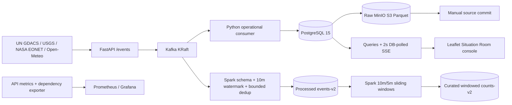

# Crisis Intelligence Platform

A cloud-native multi-hazard event streaming and geospatial telemetry platform: live UN/EC GDACS, USGS, NASA EONET (with automatic GDACS failover) and Open-Meteo ingestion, acknowledged Apache Kafka KRaft streaming, transactional PostgreSQL operational persistence, an event-time MinIO S3 Parquet data lakehouse processed by Apache Spark 3.5.1, Prometheus/Grafana observability, and a real-time Leaflet Situation Room console deployed on Microsoft Azure IaaS.

## Start and demonstrate

From PowerShell in `E:\projects\catalcysm`, start Docker Desktop. Preserve the existing ignored `.env`; for a fresh checkout only, create one with `python scripts/prepare_env.py`.

```powershell
docker compose config --quiet
docker compose up -d --build
# Wait until this succeeds:
Invoke-RestMethod http://127.0.0.1:8000/ready
docker compose exec -T fastapi python -m src.ingestion.poll_sources --usgs
docker compose exec -T fastapi python -m src.ingestion.poll_sources --gdacs
```

Open the [operations console](http://127.0.0.1:8000), [interactive architecture guide](http://127.0.0.1:8000/handbook/) and [API contracts](http://127.0.0.1:8000/docs). **[Complete Windows runbook](docs/RUNBOOK.md)** explains commands, timeouts, ports, recovery and troubleshooting; **[DEMO.md](docs/DEMO.md)** provides a timed presentation sequence.

First builds need Internet and can take time: MinIO compiles pinned upstream source; Spark downloads connectors. Live maps/CDN dependencies also need Internet. Stop services with `docker compose stop` to preserve state. Never remove volumes to make a demo pass.

## Actual architecture



DB → raw → commit arrows describe consumer processing order, not a DB export. Spark consumes Kafka independently and does not write the operational DB or run the deployed classifiers. The API uses PostgreSQL, not an in-memory fake event source.

## Verification and limits

| Capability | Current status |
|---|---|
| API validation, parameterized filters, pagination, aggregates and SSE | Verified by offline/live checks |
| Operational DB, predictions, raw archive and exact Spark event readback | Verified against running services |
| Consumer crash after DB write, replay, duplicate/conflicting identity | Verified with actual subprocess and durable sinks |
| Spark restart/dedup, controlled lateness and exact final windows | Verified in isolated actual Spark fixture |
| Current USGS observations | Verified; four observations submitted in current fetch |
| OpenWeather | Key and adapter verified; end-to-end runtime path not currently verified |
| ML | Inference connected; real-world usefulness unvalidated |
| Dashboard | Connected form/filter/details and desktop/mobile browser QA; see evidence ledger |
| Monitoring | Actual Prometheus jobs up, Grafana health and valid alert configuration |
| Cloud | Azure preparation retained; no deployment or spend |

The local runtime retains Kafka KRaft, PostgreSQL 15, Spark 3.5.1, MinIO, scikit-learn, Leaflet, Prometheus and Grafana. Exact Python container versions are in `requirements.lock.txt`; current observed versions/resources are in `docs/evidence/`. Default local Spark uses one worker core, 512 MB executor and 1536 MB driver heap. One host and broker are not high availability.

The offline suite passes **36 tests**. Three bounded 100-event runs accepted 300/300, averaging **109.31 broker acknowledgments/s**, sample standard deviation 2.94/s. This is not sustainable end-to-end capacity. Text macro F1 is **0.4467** on only ten held-out examples. Severity macro F1 near 0.9971 is from label-conditioned synthetic data and does not validate physical damage prediction.

Delivery is at-least-once with permanent operational identity and first-observation ownership; PostgreSQL, raw PUTs and Kafka offsets have no shared transaction. Spark dedup state is bounded. SSE polls the newest 500 rows per client and has no durable resume cursor. Provenance labels are declared/adapter metadata, not authenticated source proof. Full status, test boundaries and unexecuted cases are in **[VERIFICATION.md](docs/VERIFICATION.md)** and **[FAILURE_SCENARIOS.md](docs/FAILURE_SCENARIOS.md)**.

## Study and inspect

Read [the documentation index](docs/README.md) in its recommended order. The canonical Markdown collection includes architecture/sequence diagrams, a known-event trace, 13 detailed code walkthrough chapters with exact numbered source snapshots, concepts/formulas, performance methods/results, failure scenarios, runbook, **68 viva questions** and an academic report.

The [local handbook](docs/handbook/index.html) embeds these chapters, searchable concepts/source functions, clickable components and an eight-stage event journey. It also works via the API's `/handbook/` route. Regenerate source references and handbook after source/documentation changes:

```powershell
.\venv\Scripts\python.exe scripts/sync_source_reference.py
.\venv\Scripts\python.exe scripts/sync_source_reference.py --check
.\venv\Scripts\python.exe scripts/build_handbook.py
.\venv\Scripts\python.exe -m pytest tests -q --basetemp=work/pytest-manual
```

See [implementation audit](docs/IMPLEMENTATION_AUDIT.md), [durable execution status](docs/IMPLEMENTATION_STATUS.md), [measured experiments](docs/PERFORMANCE_AND_EXPERIMENTS.md), [ML interpretation](docs/ML.md) and [Azure preparation](infra/azure/README.md). Existing user Git changes and datasets were preserved; no commit, publication or cloud deployment was performed.
