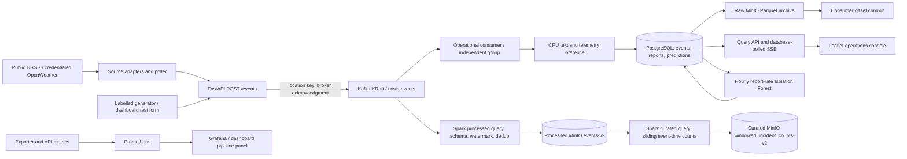
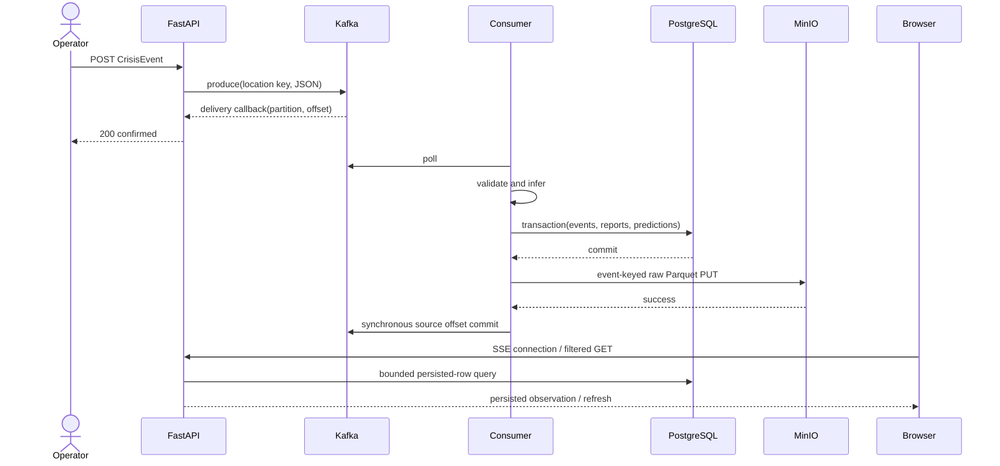

# System architecture

CATACLYSM is a local research prototype that turns heterogeneous crisis reports into queryable observations and an auditable event-time lake. It demonstrates failure recovery and separates observation from prediction. It does not perform emergency dispatch, validate eyewitness truth, estimate physical damage reliably, or provide high availability.

## Requirements and assumptions

An observation has an identity, UTC event time, narrative, coordinates, reported hazard/severity, source and metadata. Kafka is the ingestion boundary. A successful POST means the broker acknowledged a record; persistence and analytics follow asynchronously. Synthetic and replayed observations must remain identifiable. Existing state must survive container recreation. The deployment assumes a trusted local operator, one PC with approximately 16 GB RAM, Docker Desktop, and Internet for public feeds and map assets. Docker reported 16 logical CPUs and 8,172,228,608 available bytes during the current run; that is the Docker VM allocation, not total host RAM.

## Component graph

The database-to-archive arrow denotes processing order, not a database export: the consumer retains the normalized/enriched event in memory and serializes it directly. Spark consumes the original broker payload independently; processed Parquet does not contain operational model predictions. This branching distinction is essential when defending the architecture.

## Actual ingest sequence

## Why these technologies

FastAPI/Pydantic provide a typed HTTP boundary and generated contracts. Synchronous Kafka and psycopg work runs in FastAPI worker threads; the asynchronous SSE generator explicitly offloads its query with `asyncio.to_thread`. Kafka provides a retained ordered log and independent readers. Direct PostgreSQL ingestion would be simpler at this scale; Kafka is justified here by replay, consumer recovery and the independent Spark path, not by measured necessity for millions of events.

The Python consumer owns low-latency operational materialization and model inference. Spark owns event-time state and lake aggregates. PostgreSQL owns transactional, indexed user queries; MinIO holds files for analytical readback. Parquet allows column projection and compressed typed storage. These roles avoid competing Spark/consumer database writers. Prometheus samples actual services; Grafana visualizes those samples. Azure files describe a possible VM deployment and are not evidence that one exists.

## Ownership, identities and schemas

`src/common/models.py` defines the input contract. Naive legacy timestamps are interpreted as UTC; aware values are normalized to UTC. This compatibility policy must be stated to clients. Severity is one of minor/moderate/severe/critical/unknown; metadata rejects NaN and infinity. Coordinates are bounded. IDs are restricted to safe filename characters and at most 50 characters.

`crisis_events.event_id` is the operational primary key. `reports.payload` retains the enriched event and complete supported metadata. `predictions` has one row per `(event_id, model_name)`. The first accepted observation wins an ID collision; later conflicting reports do not replace observed facts or predictions. A duplicate's raw archive uses the stored original report. The raw object key includes the event date, hazard and identity: identical retries overwrite that same logical object. It is replaceable object storage, not WORM immutability. Versioned observations would need a deliberate new ID/revision policy.

Processed and curated prefixes and checkpoints are v2. They must evolve together when a stateful schema changes. Driver and worker share the checkpoint volume because executors can execute file operations. Only one driver owns each production checkpoint.

## Reliability model and proof boundaries

A crash before database commit leaves no partial transaction. A crash after database commit but before Kafka commit replays the record. Primary/unique keys prevent duplicated operational rows. A raw PUT may happen more than once. A failure after raw PUT but before offset commit repeats both sinks. There is no transaction spanning PostgreSQL, MinIO and Kafka; end-to-end exactly once is not claimed. The dedicated process-crash experiment in `evidence/crash-replay.json` exercised the actual consumer between its DB transaction and raw archival.

`acks=all` with replication factor one means the one broker acknowledged; it cannot survive loss of that broker's storage. Volumes preserve data across ordinary container restarts, not disk loss. Kafka retention can eventually remove unconsumed data. DLQ delivery must be acknowledged before the original offset commits; DLQ itself is at-least-once and may contain duplicates after a crash.

Spark's dedup state is bounded by event-time watermarking. It is not permanent identity storage. Old records may be retained in PostgreSQL/raw and absent from processed/curated layers. Curated counts are reports in overlapping windows, not unique disasters or cumulative totals.

## Scaling, memory and security limits

One operational consumer loop handles database writes, model inference and one raw object per event serially. Small-file PUT cost is a likely throughput constraint; the broker acknowledgment benchmark does not quantify it. Three source partitions limit parallel consumers in the operational group. Location keys can create hot partitions. SQL `ILIKE '%term%'`, period aggregation and large offset pagination can scan substantial data; use measured plans before adding trigram indexes or keyset pagination.

The SSE endpoint polls the newest 500 records per client every two seconds. It has no durable resume cursor and can miss arrivals outside that bounded view. The dashboard periodically refreshes from PostgreSQL; SSE is a notification mechanism, not the source of truth. Independent aggregate queries can see adjacent database snapshots while ingestion continues.

Spark has one configured worker core and a 512 MB executor, a 1536 MB driver heap and two shuffle partitions. Multiple containers on one host are separate distributed processes, but share the same physical failure domain. A second worker on this PC tests scheduling and contention, not resilience across machines. GPU acceleration has no demonstrated benefit for these small classical models.

Ports bind loopback; internal broker traffic is plaintext. The local API has no authentication, authorization or admission limits. A caller can spoof a source label: provenance reports the declared/adapter source and does not cryptographically authenticate providers. Public deployment would require authenticated ingestion, TLS, source verification, rate limits, audit/retention policy, independent ML validation, backup restoration tests and operator governance.

See `RUNBOOK.md`, `FAILURE_SCENARIOS.md`, `PERFORMANCE_AND_EXPERIMENTS.md` and the source-linked walkthrough. The current evidence ledger is `VERIFICATION.md`.
